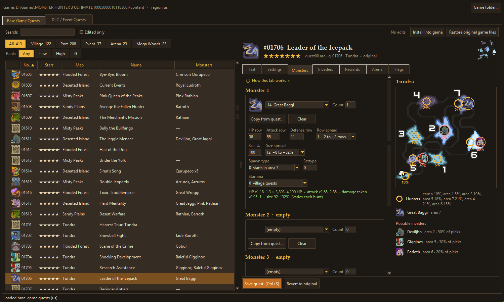
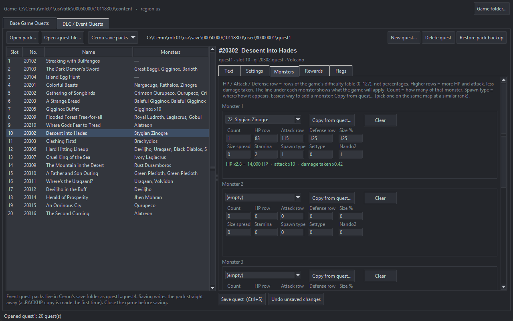

# MH3U Quest Studio

A quest editor for **Monster Hunter 3 Ultimate (Wii U)** running in Cemu. It edits:

- **Base-game quests**: the 412 Moga Village and Port Tanzia quests in `quest00.arc` / `quest01.arc`, US and EU.
- **DLC / event quests**: the `quest1`–`quest4` event packs in Cemu's save folder, and loose `.quest` files.

No game files are included. You need your own copy of the game.



## What you can change

- **Text**: name, objective, description, client and failure text, in all 5 language slots or one at a time. The game never wraps or scrolls text, so the editor warns about descriptions longer than 7 lines or lines over 39 characters.
- **Settings**: map, time limit, star rank, fee, reward money, HR points, where hunters start (base camp or a random area, with each map's odds) and the monster rank tier (low, high or G).
- **Supplies**: the supply crate, picked from a list that shows which quests use each crate and what sets it apart (its full contents are shown underneath), and when it arrives. You can choose everything at the start, part of it with the rest delivered on the game's random timer (3 to 15 minutes into a 50-minute quest) or after 2 minutes, or a delivery after the hunters hunt a set number of one monster. The editor spells out what the box will hold at the start and what comes later, and warns when a time limit makes the delivery uncertain.
- **Who can join**: the rules the game enforces (HR minimum, no armor or talismans, player limit) and the requirement line shown on the quest board, which follows the rules.
- **Invaders**: whether the area is unstable, the chance of invaders, how many, and which of the game's invader lists to use (each list shows its monsters, their odds and strength, and the quests that use it). It warns about invaders that can't spawn on the quest's map. On a quest with a Qurupeco, its call brings the invader in.
- **Objective**: hunt, capture, slay or deliver, with the target and count.
- **Monsters**: up to 5 large monsters. Pick the species, count, size and difficulty. **Copy from quest…** clones a monster from any base quest, which is the safest way to add one.
- **Rewards**: both reward columns, up to 32 items each.
- **Flags**: the quest's Category bit field.

### The difficulty numbers

Each monster has three difficulty bytes (Capcom calls them *Nando*): **HP row**, **Attack row** and **Defense row**. They are **rows in a 128-row table inside the game** (0–127), not percentages. The editor shows what each row does as you type:

> HP x1.21 = 6,050 HP · attack x2.6 · damage taken x0.95

- **HP**: max HP = the monster's base HP × the row's HP multiplier, as the game computes it at spawn.
- **Attack**: multiplier on the monster's attacks.
- **Damage taken**: every hit on the monster is multiplied by this. Lower is tougher.
- **Row spread** (*Nando2*, a dropdown): the game moves all three rows at random each hunt: 0 = fixed, 1 = up to 2 rows either way, 2 = up to 2 rows down. The editor then shows a range: Narg at Nite's Nargacuga has 5,712–6,216 HP.
- Quests with Category flag `0x10` or `0x100000` (the Grudge Match / Challenge quests) take another ×0.55 off monster HP.

Values above 127 run past the end of the table, so the editor refuses them.

### Warnings it gives you

- **Monster / map mismatch.** The game only has spawn data for some monster and map pairs. Putting a monster in slot 1 on a map it has no data for **crashes the game when the quest loads**. The editor warns before saving.
- **Objectives don't follow monster changes.** If you swap the target monster, update the objective target too, or the quest can't be completed.
- **Supplies that never come.** Only 50-minute quests are certain to get the timed delivery; other time limits can miss it, and some get none.
- **Text the game shows badly.** Descriptions over 7 lines spill off the panel, and long lines run past the box.

## Setup

1. Install **Python 3.10 or newer** from [python.org](https://www.python.org/downloads/) (tkinter is included).
2. Unzip this folder anywhere.
3. Double-click **`MH3U Quest Studio.bat`** (or run `python quest_studio.py`).
4. On first start, choose the game folder Cemu runs:
   - **Installed into Cemu:** `…\mlc01\usr\title\00050000\10118300\content` (US) or `…\10117200\content` (EU). **Add detected Cemu install** finds this for you.
   - **Loose game folder:** the folder with `code`, `content` and `meta` inside.

   The quest region (`us` / `eu`) is picked from the game's title ID.

## Editing base-game quests

1. Pick a quest on the left, edit it, and click **Save quest**. Edits are saved in the `workspace` folder, not in the game yet.
2. Click **Install into game** with the game closed. The first install backs up the original as `quest00.arc.orig`.
3. Start MH3U.

**Restore original game files** puts the backups back. Your edits stay in the workspace, so you can install them again later. **Revert to original** undoes one quest.

## Editing DLC / event quests

Open a pack from **Cemu save packs** (or **Open pack…**). The menu lists the packs of every Cemu it can find (the default install and any Cemu that's running), grouped by install folder. Pick the install you actually play on, since each Cemu has its own saves. A portable Cemu that isn't running can be added with **Add a Cemu folder…**. Edit a quest and click **Save quest**. The pack file is written straight away, and a `.BACKUP` copy is made the first time. Close the game before saving.



**New quest…** creates a brand-new event quest in the pack's first empty slot. It starts as a copy of an event quest you pick and gets a new quest number; then edit it like any other. Each pack holds 20 quests, and `quest3` is often empty. The game lists new quest numbers, and other players can join them without having the quest themselves. **Delete quest** empties a slot.

## Command line

`quest_cli.py` uses the same game folder and workspace as the GUI:

```text
python quest_cli.py list --mon "Great Jaggi"
python quest_cli.py show 2906
python quest_cli.py edit 2906 --name "My Hunt" --time 25 --mon "2:Type=Great Jaggi,Num=1,Nando_hp=40"
python quest_cli.py edit 2906 --copy-mon 2:1206
python quest_cli.py edit 11501 --invader-list 76 --invader-max 2
python quest_cli.py invaders --mon Deviljho
python quest_cli.py install
python quest_cli.py restore
```

Run `python quest_cli.py -h` for every option.

## Limits

- Base-game quests can be edited but not added. New quests go in the event packs, which have free slots.
- **Online, base-game quest edits must be installed by everyone in the room.** Each game builds the quest card and spawns monsters from its own files. In testing, a player without the edit saw the original quest and not the added monster. The quest also ended for everyone as soon as that player met their own, original objective.
- **Event (DLC) quests come from the host.** Players joining an edited event quest saw the host's edited version, so only the host needs it. US and EU players can share a room.
- Japanese version: not tested.
- Most Category flag bits are labeled only by which quests use them. Only the HP ×0.55 bits are confirmed in the game code.
- The invader, start-position, monster-rank and supply settings are explained from the game's code, and most were checked in-game on the US version. Not yet seen in-game: invaders online, the star-rank gate on invaders, and removing an intro cutscene (it only plays on a save that hasn't seen it). The invader lists themselves are part of the game's code, so quests can pick a list but not change one.

## Credits

- The difficulty-table lead came from the research log of [Cha-Cha](https://github.com/BoyClinton/Cha-Cha), BoyClinton's native PC port of MH3U.
- Quest format groundwork: Entenboot, Zindea and Gougout (community quest notes and editors).
- ARC handling: [mh3u-arc-tool](https://github.com/Matt-Wood-23/mh3u-arc-tool).

Not affiliated with Capcom or Nintendo. MIT license.
